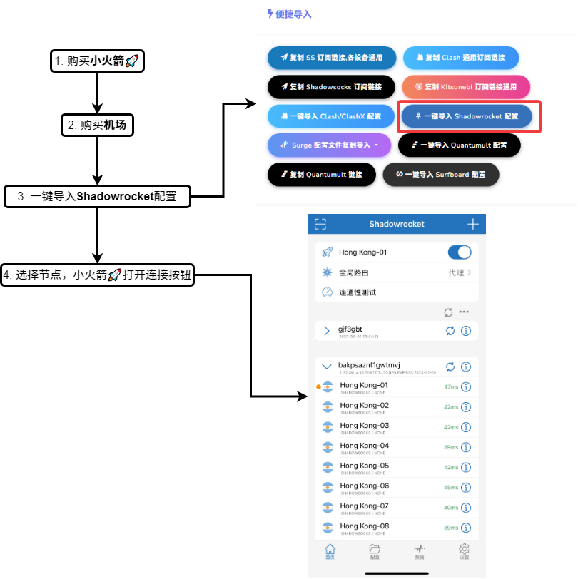
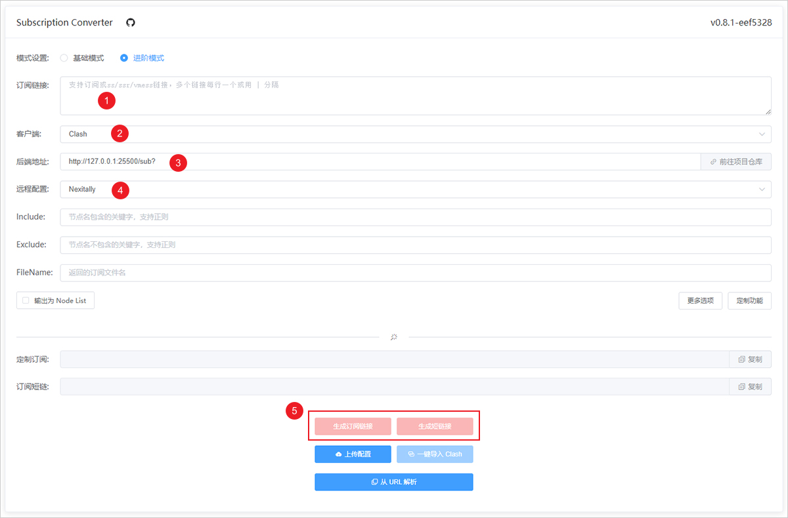
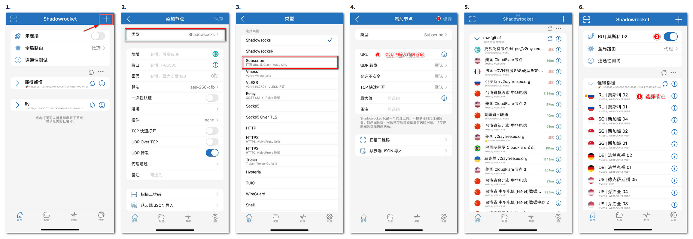
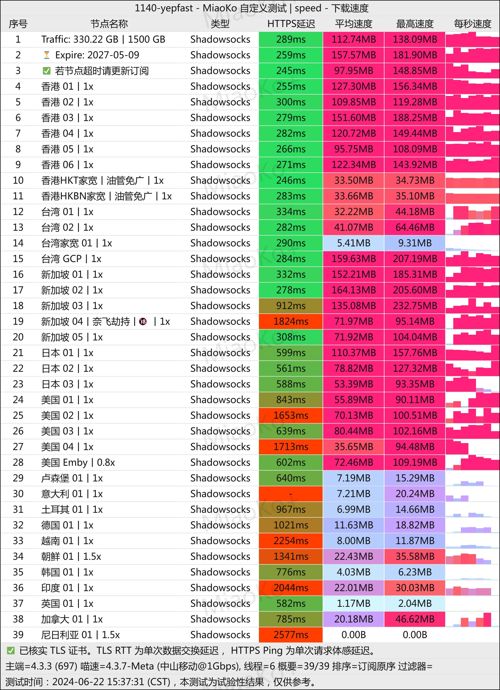
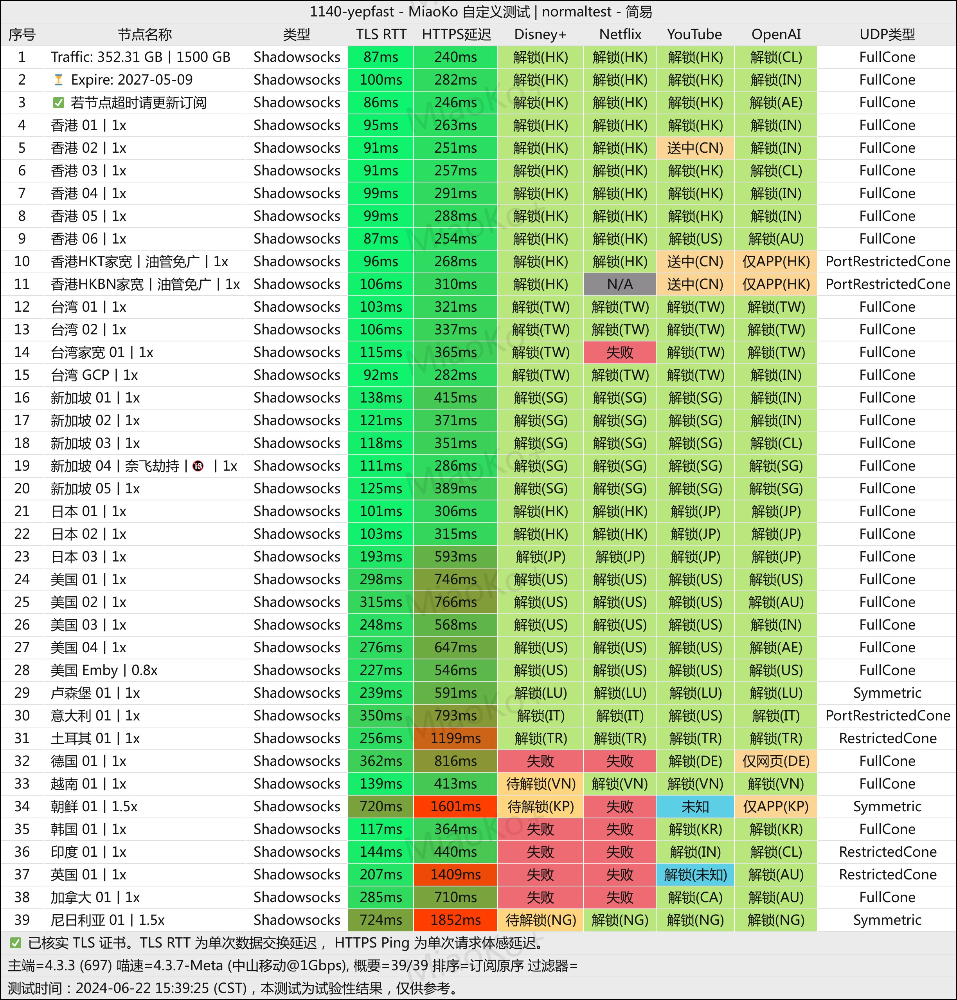
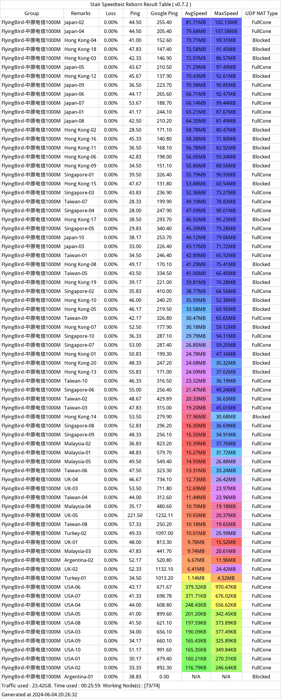
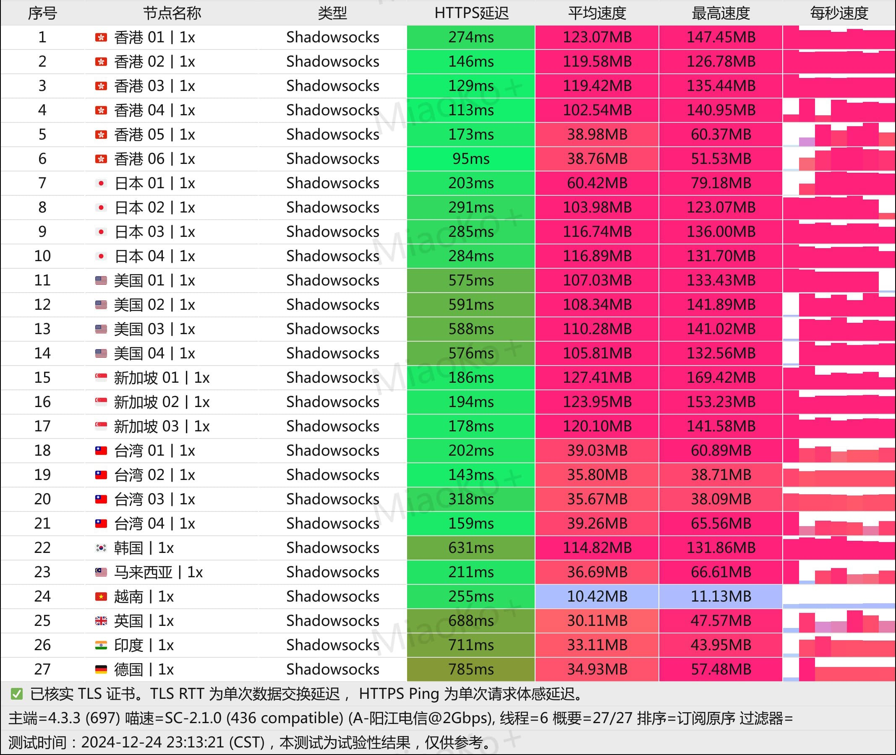
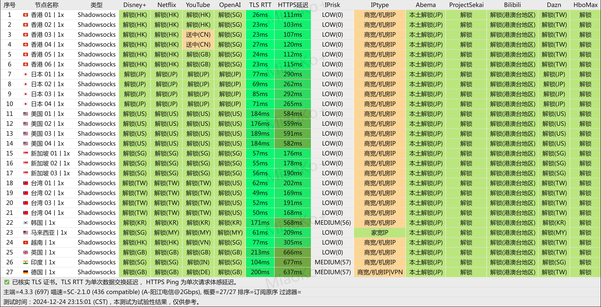
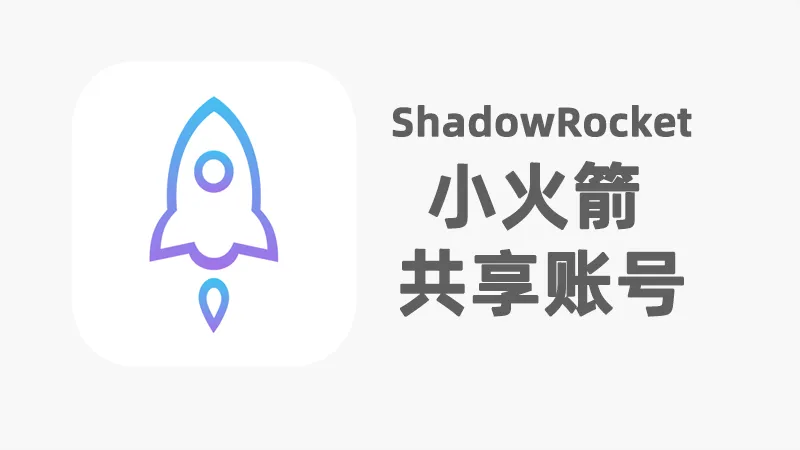

# 最新免费共享小火箭账号/已购shadowrocket共享Apple ID，小火箭账号购买，美区小火箭（2026年11月9日）

* [小火箭共享账号每日更新](https://ios.wwkejishe.top/)
* 美区 AppleID 成品独享账号：[小火箭 Shadowrocket 成品号 美国区](https://shop.wwkejishe.top/buy/6)（付费共享号近期不稳定已下架，**账号购买后可以修改密码、密保，并永久使用**）

***

> * **适合谁：** 怕麻烦、不想折腾虚拟卡、不是iPhone用户、或者就想快点搞定的朋友。

* [ChatGPT 普号 mail邮箱](https://shop.wwkejishe.top/buy/8)：**可免费使用 GPT-5.6 功能，可用于升级 ChatGPT Plus。**
* [【GPT充值】代充值1个月 ChatGPT PLUS](https://shop.wwkejishe.top/buy/53)：充值到个人账号，支持使用Codex、GPT Image 2.5、GPT-6 Astra等与官方功能保持一致
* [【GPT充值】代充ChatGPT Pro 1个月 PRO 5x 100刀](https://shop.wwkejishe.top/buy/50)：充值到个人账号
* [~~【GPT充值】代充ChatGPT Pro 1个月 PRO 质保售后版 x20 200刀~~](https://shop.wwkejishe.top/buy/51) ~~：充值到个人账号~~

> 通过正规渠道 2 分钟内即可完成 ChatGPT 充值，让每个人都能轻松订阅 ChatGPT Plus/Pro。
>
> **使用的时候如果需要手机号接码验证，需要自行解决该问题，该情况为官方风控账号，跟订阅无关。**
>
> ⚠️请注意:如果账号被封禁则无法质保,一般是账号或者使用问题，无法处理。
>
> * **充值失败全额退款**：充值失败 100% 全额退款，请放心使用我们的服务。
> * **无需海外信用卡**：没有海外信用卡也不用愁，支付宝/微信即可完成 ChatGPT Plus 代充，人人都能轻松开通。
> * **安全可靠保障**：正规代充渠道，无需提供账号密码，全程保护您的账户信息安全。
> * **极速到账**：通常 1–5 分钟内完成充值到账，Plus/Pro/Codex 全自动处理。

## 目录导航

查看文章右侧导航

## 活动通知

1. TG群：[wwkjs888](https://t.me/wwkjs888)（进群置顶消息，一年免费订阅链接，4000G流量/每月）
2. [免费机场](free-shadowrocket.md#mian-fei-ji-chang) （白嫖 60GB/月）
3. [付费机场推荐](free-shadowrocket.md#fu-fei-ji-chang)：稳定省心

## 前言声明

> 此教程为了是让大家学习，切勿做违法犯罪的事哦！

TG群：[wwkjs888](https://t.me/wwkjs888)（进群不定期更新免费订阅节点，求稳还是请看[付费机场](free-shadowrocket.md#fu-fei-ji-chang)）

* [福利：免费领取京豆](https://www.wangdu.site/software/950.html)
* [Skinny 手机卡](https://fk.wwkejishe.top/buy/13)（[常见问题指南](https://www.wangdu.site/fuliyouhui/2019.html)）：0月租稳定使用的新西兰手机卡，可用来注册 **脸书、推特、Telegram、Gmail、Tiktok、ChatGPT**（价格优惠，先到先得）
* [2026年最高性价比电信移动联通流量卡推荐](https://www.wangdu.site/fuliyouhui/2112.html)
* [IPTV](https://www.wangdu.site/software/av-read/339.html): 2026年11月更新📺IPTV电视直播源、APTV电视直播源、IPTV直播软件、超全中国+台港澳+海外IPTV直播源M3U、TV观看工具，iptv最新可用直播源iptv4/iptv6

## 🔥推荐Ti子服务器

* Just My Socks 免搭建，直接使用富强服务👍
* [2026年国外高性价比便宜 VPS 推荐(稳定、好用、免费体验)](https://bestvps.wwkejishe.top/docs/tutorial-vps/choose-vps)：可自行 [Google搭建Ti子](https://home.wwkejishe.top/search/racknerd%E6%90%AD%E5%BB%BA%E6%A2%AF%E5%AD%90)
* [2026年VPS推荐 （自用、稳定、靠谱、便宜有性价比）](https://www.wangdu.site/bestvps)（[RackNerd](https://www.wangdu.site/fuliyouhui/1266.html)、[CloudCone](https://www.wangdu.site/fuliyouhui/2115.html)、[EthernetServers](https://www.wangdu.site/fuliyouhui/2116.html)、[DMIT](https://www.wangdu.site/?golink=aHR0cHM6Ly93d3cuZG1pdC5pby9hZmYucGhwP2FmZj03OTUy) 多家VPS价格动态对比表格）

Just My Socks 懒人版（只需2步，轻松富强上网，点我展开）

1. [点击购买 洛杉矶CN2 GIA（高性价比👍）](https://justmysocks3.net/members/aff.php?aff=31458\&pid=2\&language=chinese)（享受 5.2% 永久优惠优惠码：`JMS9272283`）
2. [Just My Socks](https://justmysocks3.net/members/aff.php?aff=31458\&language=chinese) 自家的专用客户端：[Jamjams](https://justmysocks3.net/members/knowledgebase.php?action=displayarticle\&id=5\&language=chinese)（支持系统：Windows、MacOS、iOS）

## ChatGPT

> ChatGPT 是由 OpenAI 开发的一个人工智能聊天机器人程序，于 2022 年 11 月推出。该程序使用基于 GPT-3.5 架构的大型语言模型并通过强化学习进行训练。 —— 维基百科

* [ChatGPT个人注册教程](https://www.wangdu.site/course/1302.html)
* [免费ChatGPT-4o服务👍](https://www.wangdu.site/course/2097.html)
* [LiLittleCat/awesome-free-chatgpt](https://github.com/LiLittleCat/awesome-free-chatgpt): 🆓免费的 ChatGPT 镜像网站列表，持续更新。
* [ChatGPT 账号 可能含5美金 未提取API-Key | 文武科技资源](https://fk.wangdu.site/buy/8)

## Shadowsocks软件介绍

### Shadowsocks 节点获取

机场请看下面的免费机场、[付费机场](free-shadowrocket.md#fu-fei-ji-chang)（机场里就是节点）

## 小火箭+机场教程（稳定）👍

机场请看下面的免费机场、付费机场（机场里就是节点）

<figure><figcaption></figcaption></figure>

#### 免费机场如何转为小火箭（shadowrocket）节点

出于安全考虑，能自己的搭建最好自己搭建。

1. Docker部署镜像：[subconverter](https://github.com/tindy2013/subconverter/releases)（服务端）、[sub-web](https://github.com/CareyWang/sub-web)（网页端）
2. 在线订阅转换链接
   * [https://sub-web.netlify.app/](https://sub-web.netlify.app/)（sub-web作者搭建的）

<figure><figcaption></figcaption></figure>

#### 小火箭添加订阅链接

<figure><figcaption></figcaption></figure>

## Android手机APP推荐👍

### Panda（APP）

免费用户只能固定线路，有两条推荐线路，看广告可以使用1小时

免费的看视频没问题，资金雄厚的可以300多购买2年的优惠

如果用着好用，请填写我的邀请码：**28712435**，让我为你的奖励发光发热

### 猴王（APP）

免费的，速度也挺快的，就一个底部的广告

### WhaleBlue（APP）

免费的有很多线路，选择最快的起飞?️就行

### 老王（APP）

免费的线路不少，可以智能连接，看一段广告就可以使用VIP加速了。

### 客户端+机场（稳定）

1. 在 客户端（也可在下面下载地址获取高速下载链接） 下载适配适配 Android手机的客户端（推荐：Clash、Surfboard、shadowsocks-android）
2. 在下面机场选择对应的节点导入即可

## Android手机APP下载地址

### APP下载

公众号：文武科技社

回复关键词：`网上学科`

## Windows、MacOS、Android、iOS代理客户端

| 客户端名称                                                                                                                                                                                                                                                                                                                                                                                                                                                                      | 支持系统                                                                                                                                                                                                                                    | 最后更新时间 |
| -------------------------------------------------------------------------------------------------------------------------------------------------------------------------------------------------------------------------------------------------------------------------------------------------------------------------------------------------------------------------------------------------------------------------------------------------------------------------- | --------------------------------------------------------------------------------------------------------------------------------------------------------------------------------------------------------------------------------------- | ------ |
| [Pandora-Box](https://github.com/snakem982/Pandora-Box)                                                                                                                                                                                                                                                                                                                                                                                                                    | Windows、MacOS、Linux                                                                                                                                                                                                                     | 2025   |
| [mihomo-party](https://github.com/pompurin404/mihomo-party)                                                                                                                                                                                                                                                                                                                                                                                                                | Windows、Mac、Linux                                                                                                                                                                                                                       | 2025   |
| [karing](https://github.com/KaringX/karing)：兼容 Clash、V2ray/V2fly、Sing-box、Shadowsocks、Sub、Github 订阅                                                                                                                                                                                                                                                                                                                                                                        | [Win](https://github.com/KaringX/karing/releases/latest)、[Mac](https://apps.apple.com/us/app/karing/id6472431552)、[Android](https://github.com/KaringX/karing/releases/latest)、[iOS](https://apps.apple.com/us/app/karing/id6472431552) | 2025   |
| [sing-box](https://github.com/SagerNet/sing-box)                                                                                                                                                                                                                                                                                                                                                                                                                           | [MacOS、iOS](https://sing-box.sagernet.org/zh/clients/apple/)（需要美区账号：[Apple Store注册外国Apple ID教程](https://www.wangdu.site/course/705.html)）、[Android](https://sing-box.sagernet.org/zh/clients/android/)                                  | 2024   |
| [Hiddify](https://github.com/hiddify/hiddify-next)（[官网地址](https://hiddify.com/)）：全面的协议支持：Vless、Vmess、Reality、TUIC、Wireguard、Hysteria、SSH；多种订阅链接和配置文件格式支持： Sing-box、V2ray、Clash、Clash meta                                                                                                                                                                                                                                                                                  | Win、Mac、Linux、安卓、iOS                                                                                                                                                                                                                    | 2024   |
| [Bettbox](https://github.com/appshubcc/Bettbox)：使用 Mihomo（Clash Meta）内核、基于 FlClash 早期版本重构的多平台规则分流客户端                                                                                                                                                                                                                                                                                                                                                                       | Windows、MacOS、Linux、Android                                                                                                                                                                                                             | 2026   |
|                                                                                                                                                                                                                                                                                                                                                                                                                                                                            | Clash系列                                                                                                                                                                                                                                 |        |
| [Clash Mi](https://clashmi.app/download)（[使用教程](https://clashmi.app/guide/)）                                                                                                                                                                                                                                                                                                                                                                                               | iOS、MacOS、Android、Linux                                                                                                                                                                                                                 | 2026   |
| [FlyClash](https://github.com/GtxFury/FlyClash)                                                                                                                                                                                                                                                                                                                                                                                                                            | Windows                                                                                                                                                                                                                                 | 2026   |
| [clash-verge新版👍🏻](https://github.com/clash-verge-rev/clash-verge-rev)（[新版下载地址](https://clash-verge-rev.github.io/install.html)）                                                                                                                                                                                                                                                                                                                                          | Win、Mac、Linux                                                                                                                                                                                                                           | 2024   |
| [clash-nyanpasu](https://github.com/LibNyanpasu/clash-nyanpasu)                                                                                                                                                                                                                                                                                                                                                                                                            | Win、Mac、Linux                                                                                                                                                                                                                           | 2024   |
| [GUI.for.Clash](https://github.com/GUI-for-Cores/GUI.for.Clash)                                                                                                                                                                                                                                                                                                                                                                                                            | Win、Linux                                                                                                                                                                                                                               | 2024   |
| [FlClash](https://github.com/chen08209/FlClash/tree/main)                                                                                                                                                                                                                                                                                                                                                                                                                  | Win、Mac、Linux、Android                                                                                                                                                                                                                   | 2024   |
| [mihomo-party](https://github.com/pompurin404/mihomo-party?tab=readme-ov-file)                                                                                                                                                                                                                                                                                                                                                                                             | Win、Mac、Linux                                                                                                                                                                                                                           | 2024   |
| [ClashX Pro👍🏻](https://install.appcenter.ms/users/clashx/apps/clashx-pro/distribution_groups/public)                                                                                                                                                                                                                                                                                                                                                                     | Mac                                                                                                                                                                                                                                     | 2023   |
| [Clash](https://github.com/Fndroid/clash_for_windows_pkg)(已删库：20231103)、[Clash汉化包](https://github.com/BoyceLig/Clash_Chinese_Patch/releases)、[备份版本：0.20.39](https://app.nloli.xyz/static/Clash.for.Windows.Setup.0.20.39.exe)、[备份](https://archive.org/details/clash_for_windows_pkg)、[clash for windows 中文汉化备份](https://github.com/clash-hub/clash_for_windows_chinese/releases)、[clash\_for\_windows\_pkg](https://github.com/lantongxue/clash_for_windows_pkg/releases) | Win                                                                                                                                                                                                                                     | 2022   |
| [clash-verge](https://github.com/zzzgydi/clash-verge)（clash暂时替代品【老版已停更】）、                                                                                                                                                                                                                                                                                                                                                                                                  | Win、Mac、Linux                                                                                                                                                                                                                           | 2023   |
| [clashN](https://github.com/2dust/clashN)                                                                                                                                                                                                                                                                                                                                                                                                                                  | Win                                                                                                                                                                                                                                     | 2023   |
| [Fclash](https://github.com/Fclash/Fclash)（20231102只读，没有Release安装包）                                                                                                                                                                                                                                                                                                                                                                                                        | Windows、MacOS、Android                                                                                                                                                                                                                   | 2023   |
| [Clash Nyanpasu](https://github.com/keiko233/clash-nyanpasu)                                                                                                                                                                                                                                                                                                                                                                                                               | Win、Mac、Linux                                                                                                                                                                                                                           | 2023   |
| [clash-for-flutter](https://github.com/mapleafgo/clash-for-flutter)                                                                                                                                                                                                                                                                                                                                                                                                        | Win、Mac、Linux                                                                                                                                                                                                                           | 2023   |
| [Clashy](https://github.com/SpongeNobody/Clashy)                                                                                                                                                                                                                                                                                                                                                                                                                           | Win、Mac、Ubuntu                                                                                                                                                                                                                          | 2022   |
| [ClashPro](https://github.com/ClashForIOS/ClashPro)                                                                                                                                                                                                                                                                                                                                                                                                                        | Win、Mac、iOS                                                                                                                                                                                                                             | 2023   |
| [clashX](https://github.com/yichengchen/clashX)                                                                                                                                                                                                                                                                                                                                                                                                                            | Mac                                                                                                                                                                                                                                     | 2022   |
| [ClashDotNetFramework](https://github.com/ClashDotNetFramework/experimental-clash)                                                                                                                                                                                                                                                                                                                                                                                         | Win、Linux                                                                                                                                                                                                                               | 2021   |
| [OpenClash](https://github.com/vernesong/OpenClash/releases)                                                                                                                                                                                                                                                                                                                                                                                                               | 路由器                                                                                                                                                                                                                                     | 2024   |
|                                                                                                                                                                                                                                                                                                                                                                                                                                                                            | V2Ray系列                                                                                                                                                                                                                                 |        |
| [V2RayW](https://github.com/Cenmrev/V2RayW)                                                                                                                                                                                                                                                                                                                                                                                                                                | Win                                                                                                                                                                                                                                     | 2019   |
| [V2RayN](https://github.com/2dust/v2rayN)                                                                                                                                                                                                                                                                                                                                                                                                                                  | Win                                                                                                                                                                                                                                     | 2022   |
| [v2rayNG](https://github.com/2dust/v2rayNG)                                                                                                                                                                                                                                                                                                                                                                                                                                | Android                                                                                                                                                                                                                                 | 2022   |
| [V2Ray-Desktop](https://github.com/Dr-Incognito/V2Ray-Desktop)                                                                                                                                                                                                                                                                                                                                                                                                             | Mac、Win、Linux                                                                                                                                                                                                                           | 2022   |
| [V2rayU](https://github.com/yanue/V2rayU)                                                                                                                                                                                                                                                                                                                                                                                                                                  | Mac                                                                                                                                                                                                                                     | 2021   |
|                                                                                                                                                                                                                                                                                                                                                                                                                                                                            | SS系列（shadowsocks）                                                                                                                                                                                                                       |        |
| [shadowsocks-windows](https://github.com/shadowsocks/shadowsocks-windows/releases)                                                                                                                                                                                                                                                                                                                                                                                         | Win                                                                                                                                                                                                                                     | 2022   |
| [shadowsocks-android](https://github.com/shadowsocks/shadowsocks-android)                                                                                                                                                                                                                                                                                                                                                                                                  | Android                                                                                                                                                                                                                                 | 2023   |
| [ShadowsocksX-NG](https://github.com/shadowsocks/ShadowsocksX-NG/releases)                                                                                                                                                                                                                                                                                                                                                                                                 | Mac                                                                                                                                                                                                                                     | 2019   |
| [shadowsocksr(SSR)](https://github.com/shadowsocksrr/shadowsocksr-csharp/releases)                                                                                                                                                                                                                                                                                                                                                                                         | Win                                                                                                                                                                                                                                     | 2019   |
|                                                                                                                                                                                                                                                                                                                                                                                                                                                                            | 其他                                                                                                                                                                                                                                      |        |
| [Shadowrocket（小火箭）在线安装](https://shadowsockshelp.github.io/ios/)、[App Store](https://apps.apple.com/us/app/shadowrocket/id932747118)：收费，不在国区👍                                                                                                                                                                                                                                                                                                                              | iOS                                                                                                                                                                                                                                     | 2022   |
| [Quantumult X on the App Store](https://apps.apple.com/us/app/quantumult-x/id1443988620?platform=iphone)：收费，不在国区                                                                                                                                                                                                                                                                                                                                                           | iOS                                                                                                                                                                                                                                     | 2022   |
| [Loon on the App Store](https://apps.apple.com/us/app/loon/id1373567447?platform=iphone)：收费，不在国区                                                                                                                                                                                                                                                                                                                                                                           | iOS                                                                                                                                                                                                                                     | 2022   |
| [Stash on the App Store](https://apps.apple.com/us/app/stash-rule-based-proxy/id1596063349?platform=iphone)：收费，不在国区                                                                                                                                                                                                                                                                                                                                                        | iOS                                                                                                                                                                                                                                     | 2022   |
| [OneClick](https://github.com/oneclickearth/oneclick)                                                                                                                                                                                                                                                                                                                                                                                                                      | 安卓、iOS                                                                                                                                                                                                                                  | 2022   |
| [Clash👍🏻](https://apkpure.com/cn/clash-for-android/com.github.kr328.clash/versions)                                                                                                                                                                                                                                                                                                                                                                                      | 安卓                                                                                                                                                                                                                                      | 2022   |
| [ClashMetaForAndroid](https://github.com/MetaCubeX/ClashMetaForAndroid/releases)👍🏻                                                                                                                                                                                                                                                                                                                                                                                       | Android                                                                                                                                                                                                                                 | 2026   |
| [Wrap+](https://1.1.1.1/)：Cloudflare 公司开发的，[教程：Warp+ 24PB 无限流量密钥](https://www.ahhhhfs.com/40632/)                                                                                                                                                                                                                                                                                                                                                                          | Win、Mac、Linux、安卓、iOS                                                                                                                                                                                                                    | 2023   |
| [Surfboard](https://manual.getsurfboard.com/)                                                                                                                                                                                                                                                                                                                                                                                                                              | 安卓                                                                                                                                                                                                                                      | 2023   |
| [Surge](https://nssurge.com/)：收费，不在国内                                                                                                                                                                                                                                                                                                                                                                                                                                      | Mac、iOS                                                                                                                                                                                                                                 | 2023   |
| [Clash Apple 原生客户端](https://clash.md/zh/)                                                                                                                                                                                                                                                                                                                                                                                                                                  | iOS、MacOS、TvOS                                                                                                                                                                                                                          | 2026   |
| [塔台](https://apps.apple.com/us/app/%E5%A1%94%E5%8F%B0/id6797458927?l=zh-Hans-CN)（[github地址](https://github.com/pengchujin/tower)）：收费（$1.99），美区，原生 SwiftUI iOS App，本地管理机场订阅与自有节点                                                                                                                                                                                                                                                                                            | iOS                                                                                                                                                                                                                                     | 2026   |
| [openwrt-passwall2](https://github.com/xiaorouji/openwrt-passwall2/releases)                                                                                                                                                                                                                                                                                                                                                                                               | 路由器                                                                                                                                                                                                                                     | 2024   |
| [helloworld](https://github.com/fw876/helloworld)                                                                                                                                                                                                                                                                                                                                                                                                                          | 路由器                                                                                                                                                                                                                                     | 2024   |

## 其他教程

* [使用不限流量的cloudflare VPN并且自选IP](https://duangks.com/archives/124/)：需要富强
* [WARP-Clash-API👍](https://github.com/vvbbnn00/WARP-Clash-API)：该项目可以让你通过订阅的方式使用 Cloudflare WARP+，自动获取流量（[在线服务](https://tofree.zeabur.app/)：支持Clash、Surge、Shadowrocket）
* [使用Github Action搭建全自动永久免费获取机场节点/订阅](https://linux.do/t/topic/96234)

## 机场测速

[DuyaoSS](https://www.duyaoss.com/)

## 免费机场（不保证都可用/多切换试试）

可以使用 [在线订阅转换链接](free-shadowrocket.md#mian-fei-ji-chang-ru-he-zhuan-wei-xiao-huo-jian-shadowrocket-jie-dian) 转为符合自己客户端的链接

### 免费机场

* [宝可梦](https://web3.52pokemon.cc/register?code=OD5C6b6T)：白嫖 60GB/月，入门套餐 ￥7.9，11月白嫖码：`咕咕`

### 免费clash订阅链接

其他客户端可通过在线订阅转换链接自行转换，喜欢折腾的可以通过 教程 自行搭建

* clash 订阅链接：`https://qyoo.aibvs.cn/api/v1/client/subscribe?token=d1238234772e17cc53229bcbb74980ed`
* Clash 订阅地址：`http://777.hz.cz/Clash-11041936.yaml`

### 免费SS账号

[https://free-ss.site](https://free-ss.site/)

### SS/SSR 免费节点订阅地址

* [https://raw.githubusercontent.com/ssrsub/ssr/master/ssrsub](https://raw.githubusercontent.com/ssrsub/ssr/master/ssrsub)
* [https://www.liesauer.net/yogurt/subscribe](https://www.liesauer.net/yogurt/subscribe?ACCESS_TOKEN=DAYxR3mMaZAsaqUb)
* [免费ssr节点分享](https://freefq.com/free-ssr/)：所有账号、节点或服务器均源自国际互联网

### 免费节点GitHub库

PS：**下面仓库中付费的内容，请谨慎购买，只推荐使用免费**，下面付费机场为博主在用的，求稳定的还是使用付费的吧。

* 小火箭 / V2RAY 订阅地址：`https://www.xrayvip.com/free.txt`
* Clash 订阅地址：`https://www.xrayvip.com/free.yaml`
* [getNode](https://github.com/Flik6/getNode)：每小时更新最新的 Clash、v2ray 节点信息
* [v2cross](https://v2cross.com/archives/1884)：SS 节点（富强获取）
* [Free-servers](https://github.com/Pawdroid/Free-servers): 6小时更新一次，免费ss/v2ray/trojan节点
* [v2rayfree](https://github.com/aiboboxx/v2rayfree): v2ray节点

### TG群

* [长风分享频道](https://t.me/changfengchannel)：每4小时更新一次，最多一次显示50条

### 网站

* [长风分享](https://www.cfmem.com/search/label/free)：每天更新 Clash、v2ray 节点信息

## 付费机场

PS：**最好月付，防止跑路！**

### YepFast（博主在用👍🏻）

[YepFast](https://g8n2thko.yepfast.link) 有自家的 `Windows、macOS、Android` 客户端，更加方便快捷，iOS 用户还是得需要下载小火箭使用（稳定极速，40+节点，高端节点，海外团队，安全可靠）

* 备用网址：[YepFast](https://g8n2thko.yepfast.link)

套餐：

* 11.9元/月（年付￥120）
* 160G 流量/月
* 40+ 椰汁畅享中继线路
* 支持港澳台及国外地区使用
* 完美使用海外流媒体 及 AI 服务
* 不限本人设备数，最高500Mbps速率

> **节点使用 AnyTLS 协议**，请确保您的第三方客户端为最新版本，以正常使用。如无法使用请点击帮助，使用官方客户端。
>
> 不支持的客户端：
>
> * Clash for Windows（内核过旧需更换）
> * 远古版本的 ClashX、Clash Meta、Clash for Android（内核过旧需更新）
> * Hiddify、v2rayNG、Xray 等不支持 AnyTLS 协议的内核及客户端

YepFast测速图&#x26;解锁图

YepFast测速图

YepFast解锁图

### FlyingBird（博主在用）

[FlyingBird](https://fbinv02.fbaff.cc/auth/register?code=jvQ5)（70+节点，全专线IPLC，不限速，不限设备数量，超稳晚高峰，流媒体全解锁！全节点解锁chatgpt！）

* 备用网址: [FlyingBird](https://fbweb02.flyingbird.la/auth/register?code=jvQ5)
* 备用网址: [FlyingBird](https://fbweb02.flyingbird.id/auth/register?code=jvQ5)
* 备用网址: [FlyingBird](https://web02.fbcn.pro/auth/register?code=jvQ5)

套餐：

* 100GB / 15元 / 30 天
* 不限制客户端数量
* 不限制速度
* 支持所有节点线路
* 流媒体解锁
* 全节点支持ChatGPT等AI工具
* 支持大陆及海外全球用户使用

FlyingBird测速图

FlyingBird测速图

### 鹿语云（IEPL专线机场，博主在用）

[鹿语云](https://czolvxmh.luyuyun.link)：（稳定极速，20+节点，全节点IEPL专线，全节点流媒体解锁，全节点支持ChatGPT等AI工具，海外团队，安全可靠）

* 备用地址：[鹿语云](https://czolvxmh.luyuyun.link)

**活动内容如下：**

* 季付/半年付85折，优惠码：`202685`
* 年付8折，优惠码：`202680`

**活动有效期：**

即日起至 2026/10/8 23:59

套餐

* 50GB / 16元 / 1月（年付：119元）
* 150GB / 26元 / 1月（年付：259元）
* 全节点IEPL专线，低延迟，支持游戏加速
* 全节点流媒体解锁
* 全节点支持ChatGPT等AI工具

鹿语云测速图&#x26;解锁图

鹿语云测速图

鹿语云解锁图

### 一元机场

[一元机场](https://xn--4gq62f52gdss.ink/#/register?code=HUliZ7Oi)：适用追求价格便宜，对上外网需求不大，稳定性不高；求稳请看上面几款付费机场

套餐

* 年付12元，1元/月 | 两年付20元，0.8元/月
* 月流量：50G
* 地区：香港日本新加坡美国
* 解锁 Netflix, Disney+
* 不限速，不限连接数
* 请知悉无退款服务

## 国内访问国外服务

PS：最好月付，防止跑路！

> 都有自家的客户端，需要订阅链接的可以联系客服

### 云界线

[云界线](https://itxh888.yunjiexianaff.com/#/?code=BAZI2UhW)（60+节点，流媒体全解锁！全节点解锁chatgpt！）

* [官网地址](https://itxh888.yunjiexianaff.com/#/?code=BAZI2UhW)

> **新客享受7折优惠. 收单低至13.92**
>
> 云界线采用全 IPLC 专线，年付 96 元每月 60GB，月付 22 元起提供每月 150GB 流量。单节点峰值最高 2.5Gbps，支持原生 IP、主流 AI 与流媒体服务解锁，不限制同时使用客户端数量。

### 环球梯

[环球梯](https://itxh888.huanqiutiaff.com/#/?code=JkQ1UMPO)

* [官网地址](https://itxh888.huanqiutiaff.com/#/?code=JkQ1UMPO)（7折优惠码：`HQ66`）

> 环球梯是一家主打低价的国内可用便宜机场，套餐为月付 15 元 60GB、19 元 110GB，另有年付与按量可选。全线采用 VLESS + 专线架构，节点覆盖香港、台湾、日本、新加坡、美国等 60+ 地区，常用流媒体与 ChatGPT 等 AI 服务可解锁，支持支付宝、微信付款，不限制设备数量。注册后在用户中心复制订阅链接即可导入 Shadowrocket（小火箭）、Clash 等第三方客户端，也可通过客服或工单获取订阅地址。

* 套餐灵活：月付、年付和按量套餐均可选择，最低 ¥8/月
* 流量充足：提供每月 60GB—600GB 不同档位
* 多设备支持：设备无限制
* 应用支持：部分套餐支持常用流媒体与 AI 服务
* 用户覆盖广：适合学生、个人用户、家庭共享及高流量用户
* 硬核线路与协议：全线采用最新 VLESS 协议 + 纯专线 架构，晚高峰轻松跑满 4K/8K，敏感时期抗封锁能力强。
* 节点丰富与解锁：覆盖港/台/日/新/美等60+ 核心节点，全解锁 Netflix、Disney+ 及 ChatGPT 等 AI 服务。
* 支付便捷：支持支付宝、微信

### 跨界云

[跨界云](https://itxh888.kuajieaff.com/#/?code=HAYHRxLw)

* [官网地址](https://itxh888.kuajieaff.com/#/?code=HAYHRxLw)

> 跨界云是 2026 年新开的机场，节点覆盖香港、新加坡、日本、美国、台湾 5 个地区，共 50 个节点。官方客户端全平台可用，邮箱密码登录就能用，不需要订阅链接；习惯用 Clash、小火箭的也能直接导入。

套餐

* 下单时填优惠码： `kuajie` 可打 8 折（新老用户都能用，月付到三年付、流量重置都适用，没有到期时间。）
* 以下两档不参加优惠码：跨界年付版 ¥96/60GB、跨界·不限时包 ¥200/300GB。
* 跨界年付版 ¥150/100GB 能否用码以结算页为准。

节点与速度

* 节点：香港 15 个、新加坡 10 个、日本 10 个、美国 10 个、台湾 5 个。
* 官方 2026 年 8 月 2 日晚 9 点（晚高峰）的测速报告：（以下为官方测速报告，实际速度以你所在地区网络为准。官方说明：全部节点 1 倍率计费，标称流量即可用流量。）
  * 香港 153–235 MB/s
  * 新加坡 105–180 MB/s
  * 日本 93–152 MB/s
  * 台湾 73–103 MB/s
  * 美国 36–64 MB/s；
  * YouTube、Netflix、Disney+ 50 个节点全部解锁。

### 无忧链接

[无忧链接](https://itxh888.worryfreeaff.com/#/?code=z3Ys3Jv2)：2025 年开业的 IPLC 专线机场，海外团队运营，全线 VLESS 协议。解锁 ChatGPT、Gemini 等 AI 服务与 Netflix、Disney+、YouTube 等流媒体，TikTok 多地区可用；不限速、不限制同时在线设备数量，全天客服轮班。

* [官网地址](https://itxh888.worryfreeaff.com/#/?code=z3Ys3Jv2)
* [无忧链接落地页](https://wyit.site/)：套餐对比、优惠说明、客户端导入与常见问题

| 项目     | 说明                                      |
| ------ | --------------------------------------- |
| 开业时间   | 2025 年                                  |
| 线路类型   | IPLC 专线                                 |
| 协议支持   | VLESS                                   |
| 节点入口   | 港 / 台 / 新 / 日 / 美，另覆盖东南亚及欧美多个国家         |
| 流媒体解锁  | Netflix、Disney+、YouTube 等               |
| 客户端支持  | Clash、Shadowrocket（小火箭）、Sing-box、v2rayN |
| 限速情况   | 无速率限制                                   |
| 同时在线设备 | 不限制                                     |
| 支付方式   | 支付宝 / 微信 / USDT                         |
| 客服支持   | 全天客服轮班、Telegram 在线客服                    |

套餐

| 套餐     | 月流量   | 月付  | 季付  | 半年付 | 年付   |
| ------ | ----- | --- | --- | --- | ---- |
| mini链接 | 40GB  | —   | —   | —   | 79   |
| 舒心链接   | 100GB | 19  | 51  | 96  | 182  |
| 省心链接   | 200GB | 33  | 89  | 168 | 316  |
| 随心链接   | 500GB | 77  | 207 | 392 | 739  |
| 忘忧链接   | 1TB   | 117 | 315 | 596 | 1123 |

> ⭐️ **活动内容：** 全线订阅 6.8 折，优惠码：`wuyou666`（79 元年付包不参与）

特点

* 提供 40GB 轻量档，折合低至 ¥6/月起，适合用量小的用户
* 订阅链接无需转换，iOS / 安卓 / Windows / macOS 客户端可直接导入
* 套餐无倍率、不限速、不限制设备数量
* 可做跨境电商、TikTok 运营与直播，TikTok 多地区可用
* Netflix / Disney+ / YouTube 稳定性和兼容性在线
* 支持支付宝 / 微信 / USDT 支付

## 国外访问国内服务（一键回国）

### 快帆

[快帆加速器](https://af.kuaifan.club/scripts/chm1f4?a_aid=68381ef23e3a7\&a_bid=cdf44841)：给海外用户把网络“切回中国大陆”，解锁仅限大陆 IP 的视频（打开爱奇艺优酷或腾讯视频，经常显示 **「您所在的地区无法观看该视频」** 想看却看不了？）/音乐（网易云音乐、QQ音乐，歌单总是灰色？）/直播/办公/社交等内容；支持按应用加速。

快帆详细介绍（点我展开）

#### 适用场景

* **定位**：给海外用户把网络“切回中国大陆”，解锁仅限大陆 IP 的视频/音乐/直播/办公/社交等内容；支持按应用加速。
* **平台覆盖**：提供 Android / iOS / Windows / macOS / Android TV 客户端。

#### 关键功能与特性

* **按应用走代理**：Android 端可选择哪些 App 使用代理。
* **线路与模式**：宣称 **150+ 加速线路**、含“游戏专线/直连/中转”等，iOS 端强调 **Fanster™ 专线**。
* **并发设备**：**同一账号最多 3 台设备同时在线**（设备类型不限制）。支持企业/团队**扩容并发**与**定制独享大陆 IP 专线**。
* **TV 大屏**：有独立 **Android TV** 客户端，适配机顶盒/智能电视。

#### 价格与退款（以实际页面为准）

* **官网套餐页**（人民币）：**360 天 ¥480、90 天 ¥125、30 天 ¥45**。
* **iOS 内购**（美元示例）：**年 $55.99–74.99、季 $12.99、月 $4.49–6.99**（页面会随地区/版本变动）。
* **退款政策**：官网帮助中心写明 **7 天内可退**；按已用天数+约 **6% 手续费**扣除；App Store 购入需按苹果规则。自动续费条款也在服务协议中单列（自动扣费期内通常**不退**）。

#### 隐私与口碑

* App Store 隐私页：可能用于追踪的数据含联系方式、标识符等；开发者名显示 **Beijing next generation access Acceleration CO.LTD**。
* Google Play“数据安全”页：声明**不与第三方共享数据**；应用可能收集个人/财务信息、设备 ID 等。开发者信息显示 **BOHAN TECHNOLOGY LIMITED / KuaiFan Global**。
* **评分参考**：iOS 约 **4.8/5（\~926 评）**；Google Play 约 **4.5/5（\~885 评，10万+ 下载）**。口碑受地区/时段/线路影响波动较大。

#### 快速优缺点

**优点**

多平台一键用、移动端有**免费线路**可试；3 端并发；提供企业定制（并发/独享大陆 IP）。

**注意/不足**

* **主要面向“回国”方向**；游戏加速效果依网络与地区差异较大（官方也建议换线路/环境排障）。
* 价格在同类中属中等偏上；不同渠道（官网/内购）价格与退款规则不一致，购买前需核实。

### Malus

Malus 加速器官网：[Malus](https://getmalus.com/buy?affid=A328464971F)

* 身在海外玩国服游戏延迟高经常掉线？玩游戏、听音乐、看直播，经常延迟高、卡顿丢包、无法连接和播放？用 [Malus](https://getmalus.com/buy?affid=A328464971F) 回国加速器一键加速，超低延迟不丢包，畅玩全球游戏，提高网络稳定性。加速王者荣耀、魔兽世界、LOL英雄联盟 、原神、和平精英、永劫无间、剑网3、CS:GO等等国服/美服/亚服/欧服国际服游戏、还可以加速优酷、Bilibili、爱奇艺、腾讯视频、QQ音乐、网易云音乐、酷狗音乐、CCTV、腾讯体育NBA、YY语音、央视CCTV、咪咕视频、OBS、直播姬等平台。
* **全平台支持，随时随地回国加速**：[Malus](https://getmalus.com/buy?affid=A328464971F) 加速器，现已全面支持苹果iPhone & iPad移动设备、Android手机、Windows PC系列、苹果 macOS 电脑、也可以支持 Android 系统的TV电视盒子。确保您在任何一个设备和平台上都可以顺畅加速回国。
* **一键智能加速**：[Malus](https://getmalus.com/buy?affid=A328464971F) 回国加速器使用独创的边缘节点技术加速，服务器智能分流，按需加速，效果稳定快速。智能加速模式，系统自动根据您所在地区自动选择最佳节点。
* **国际高速线路，超稳定，低延迟**：[Malus](https://getmalus.com/buy?affid=A328464971F) 回国加速器在全球提供上百条高速线路，实时监控带宽流量动态调整，保证节点通道畅通，不限流量，不限时长，满足各个地区和国家的加速需求。线路动态分配，自动选择最优，为您提供沉浸式加速体验。

### 穿梭

[穿梭](https://www.transocks.com/payment?affiliate-code=m75z3zj) 成立于2017年，也是一款老牌回国VPN，在全球部署了100多条回国专线，采用先进的智能选择线路技术，连接稳定且速度较快，支持Windows、Mac、iOS、Android和智能电视等设备，价格相对较为便宜，每天仅需0.72元，也提供24/7中文在线客服。

* 穿梭现已全面支持iPhone & iPad、Android手机、Windows、macOS、Android电视盒子，更有浏览器插件可供选择

## Shadowrocket小火箭账号

更新时间：2025年9月9日

[小火箭共享Shadowrocket账号每日更新](https://ios.wwkejishe.top/)（博主自维护）

注意：**切勿在设置登陆iCloud账号！！不要点升级！不要点升级！不要点升级！**

1. 美区AppleID成品账号（已增加库存，数量有限，先到先得）：[小火箭 Shadowrocket 成品号 美国区](https://fk.wangdu.site/buy/6)（**账号购买后可以修改密码、密保，并永久使用**）
2. 共享账号容易失效，需要稳定的可购买成品账号
3. 美区AppleID共享小火箭：[小火箭id共享账号，租用已购此App账号](https://fk.wangdu.site/buy/7)下载，租用与独享账号下载的 App 没有区别，下载的 App 只要不删除永久可用，`只是后续不能升级`。

### 共享苹果ID站点

<figure><figcaption>
2026年最新iOS免费小火箭ShadowRocket共享账号
</figcaption></figure>

**此为第三方站长，只做分享，不保证质量安全，不解决使用中出现的问题**

**🔴️ 使用免费共享苹果账号必须从 App Store 登录，千万不要登录「iCloud」，否则可能导致锁机或者隐私泄漏！**

* ~~免费共享shadowrocket小火箭账号：有带shadowrocket的美区账号、台湾区、日本区、韩国区、香港区、英国区、土耳其区、俄罗斯账号~~
* ~~AneeoApple：里面有美国、国区账号，密码需要关注Telegram群/公众号来获取~~
* [Shadowrocket共享账号 - 免费小火箭Apple ID分享 | iOS下载教程](https://shadowrocket.best/)
* [【免费】2026 小火箭共享账号 | 美区ID / 苹果ID共享 (已购Shadowrocket) - 翻墙男](https://fanqiangnan.com/appleid.html)
  * 提供 **已购 Shadowrocket 的美区 Apple ID**，同时覆盖 **港区 / 日区 / 台区**，账号状态 **每 30 分钟自动检测并更新**

### 使用教程

## 客户端使用教程

### Windows-v2rayN使用教程

Windows-v2rayN使用教程

1.  在 付费机场 已经购买好套餐，下载v2rayN客户端 [点击下载](https://dl.flyingbird.vip/apps/v2rayn_win.zip) 下载后解压并运行 v2rayN.exe

    
2.  登陆机场官网`复制SS通用订阅地址 / 导入Shadowrocket`

    
3.  点击v2rayN订阅 --> 订阅设置 --> 添加订阅并确定

    

    

    
4.  更新订阅 --> 得到服务器节点

    

    
5.  选择节点并回车选中

    
6.  在电脑右下角任务栏开启你的代理并尽情享用高速网络

    

### Windows-Clash使用教程

Windows-Clash使用教程

1.  在 付费机场 已经购买好套餐，下载Clash客户端 [点击下载](https://dl.flyingbird.vip/apps/clash_win.zip) 并解压运行 Clash for Windows.exe

    
2.  打开机场官网，点击`一键导入Clash配置`

    

    
3.  导入后选 Proxies，并选择 Rule 模式和节点

    
4.  选 General 并启用系统代理，尽情享受高速上网

    

### Shadowsocks软件介绍及使用教程

Shadowsocks软件介绍

**SS**，全称为 **Shadowsocks**（下文简称为`SS`），是一种基于 Socks5 代理方式的网络数据加密传输包的工具，可以使用其于**科学上网** _也就是翻墙_ ，是目前最稳定，最常用的科学上网工具之一，**全平台支持**

**SSR**，全称为 **ShadowsocksR**（下文简称为`SSR`）。ShadowsocksR 是breakwa11发起的Shadowsocks分支，在Shadowsocks的基础上增加了一些数据混淆方式，称修复了部分安全问题并可以提高QoS优先级。后来贡献者Librehat也为Shadowsocks补上了一些此类特性，甚至增加了类似Tor的可插拔传输层功能。

Shadowsocks使用教程

以SS为例，SSR差不多

1. （**具体信息**的订阅地址）右击**小飞机**，打开**服务器 - 编辑服务器**，输入服务器信息即可。
2. （**图片二维码**的订阅地址）右击**小飞机**，打开**服务器 - 扫描屏幕上的二维码**，服务器信息自动导入。
3. （**长链接**的订阅地址）右击**小飞机**，打开**服务器 - 从剪切板导入URL**，服务器信息自动导入。

**Shadowsocks 节点获取**

机场请看下面的免费机场、付费机场（机场里就是节点）

### MacOS-ClashX Pro使用教程

MacOS-ClashX Pro使用教程

1. 在 付费机场 已经购买好套餐，下载MAC版本ClashX Pro [点击下载](https://dl.flyingbird.vip/apps/clashx_mac.dmg) ，安装并启动
2.  打开机场官网，点击`一键导入ClashX配置`

    
3.  点击`一键导入Clash/ClashX配置`后会跳出上面对话框，然后点OK

    
4.  软件会自动加载订阅，当你看到上面的日期后就是导入成功，然后关掉就可以了。

    
5.  在你电脑的最顶上状态栏里会出现 ClashX Pro 的图标，如果没看到这处图标就是你开太多东西了，关掉一些应用程序，直到你看到这个图标。

    
6.  选择 Rule 模式

    
7.  选择节点

    
8.  启动系统代理！到这一步你就可以正常浏览器代理上网了。如果你想让整台电脑所有的应用都开启代理，可以把下面的Enhanced Mode也打勾就可以了。

    

### Android安卓-Clash使用教程

Android安卓-Clash使用教程

1.  在 付费机场 已经购买好套餐，下载安卓Android-Clash [点击下载](https://dl.flyingbird.vip/apps/clash_android.apk) ，安装并启动

    
2.  打开机场官网，点击`一键导入Clash配置`

    

    
3.  选择配置并激活机场配置

    

    
4.  运行代理并选择节点，享受高速上网

    

    

#### iOS苹果-Shadowrocket使用教程

iOS苹果-Shadowrocket使用教程

### CloudFlare WARP客户端使用教程

> 推荐使用上面客户端+机场的组合

Cloudflare WARP 是一种由Cloudflare推出的网络加速和安全服务，旨在通过将用户的网络流量路由到Cloudflare的全球骨干网络中来实现加速和优化用户的网络体验。它使用了现代的加密协议（如WireGuard），以确保用户数据的安全性和隐私性。

CloudFlare WARP客户端使用教程

1.  Windows版优选和更换IP，解压文件后（看下图解）

    

    * 下载[Warp优选IP和更换IP.rar](https://img.ccbaohe.com/warp%E4%BC%98%E9%80%89IP%E5%92%8C%E6%9B%B4%E6%8D%A2IP.rar) / [CloudflareSpeedTest](https://github.com/XIU2/CloudflareSpeedTest)（「自选优选 IP」测试 Cloudflare CDN 延迟和速度，获取最快 IP ！当然也支持其他 CDN / 网站 IP \~） 并解压，点击优选ip，优选完毕后会自动生成 result.csv 文件。
    * 打开 result.csv 文件，任意复制一条IP。
    * 打开更换IP，输入复制的IP。回车既可更换可以用IP
2.  下载并安装客户端：打开官方地址： [https://1.1.1.1/zh-Hans/](https://1.1.1.1/zh-Hans/) ，选择适合自己平台的客户端下载

    
3.  Warp+24PB 无限流量密钥

    * 使用Telegram电报搜索：[@generatewarpplusbot](https://t.me/generatewarpplusbot)，找到这个机器人，点击开始，然后点击`/generate`。它要求我们订阅三个群组，这个直接订阅就行。
    * 再次点击`/generate`，就会给我们生成密钥。

    
4.  客户端安装并启动客户端并连接节点

    启动CloudFlare WARP时候，有可能遇到无法注册的问题：由于注册服务域名被GFW阻断。

    第一次打开客户端之前，需要打开代理软件的真全局模式（例如：Clash的TUN模式），如在手机上则打开任意代理软件即可 进入设置选项，Device ID出现非0000的字符串时，即为注册成功

    

    

    断开并关闭代理软件，连接 WARP。如出现 Connected 即为连接成功

    

    如一直处在 Connecting 状态，则说明目前 WARP 服务已被 GFW 阻断；更换 WARP+ 密钥

    

    

    切换为Teams账户：打开客户端之前，需要打开代理软件的真全局模式（例如：Clash的TUN模式)，如在手机上则打开任意代理软件即可 打开WARP客户端 按照下图操作

    

    

## 作者网站

* [文武科技柜](https://www.wangdu.site/)：实用工具、黑苹果、高效教程、Nas
* [文武软件百科](https://wiki.wangdu.site/)：致力于软件的百科全书
* [文武帮助中心](https://help.wwkejishe.top/)：包含小火箭共享账号及使用教程、IPTV直播源、Skinny电话卡

## 常见问题

### 为什么不能在"设置"中登录小火箭共享账号？

在"设置"中登录shadowrocket apple id会同步iCloud数据，可能导致您的个人数据泄露或被覆盖。小火箭共享账号仅应在App Store中使用。

### shadowrocket共享账号提示"已锁定"或"密码错误"？

小火箭共享账号可能因使用人数过多而被临时锁定。请等待页面自动更新新的shadowrocket apple id，或稍后再试。本站每小时都会检测小火箭共享账号可用性并自动更新。

### 如何获取shadowrocket节点订阅链接？

订阅链接是包含多个节点配置信息的URL地址，Shadowrocket可以通过订阅链接自动导入所有节点。您可以通过以下方式获取订阅链接：

* **🏆 购买稳定机场**（推荐）- 注册机场服务商账号后，在用户中心或订阅页面可以找到订阅链接，复制后添加到Shadowrocket即可。选择稳定可靠的机场服务商，确保节点质量和稳定性。
* ❌ 搜索不稳定的节点分享网站（不推荐）- 这些网站的节点通常质量差，频繁掉线、速度慢、经常失效，不适合长期使用
* ⚙️ 自建服务器生成订阅（需要技术能力）- 如果您有自己的VPS服务器，可以自行搭建代理服务并生成订阅链接

获取订阅链接后，按照上方"订阅链接导入"部分的步骤操作即可完成配置。

### 连接后无法上网怎么办？

可能的原因和解决方案：

1. 节点失效 - 尝试切换其他节点
2. 订阅过期 - 联系服务商续费
3. 路由设置问题 - 检查全局路由设置
4. 网络限制 - 尝试切换WiFi或移动网络

### Windows/macOS/Linux电脑操作系统如何使用shadowrocket？

Shadowrocket 只适用于iOS系统，电脑端无法直接使用小火箭。如果您需要在 Windows、macOS 或 Linux 电脑上使用代理工具，推荐使用上方客户端列表里的 Clash Verge Rev。

## 故障排查

### 节点延迟很高

使用Shadowrocket的「连通性测试」功能测试所有节点，选择延迟最低的使用。如果所有节点延迟都很高，建议更换机场服务商。

### 为什么推荐稳定的机场服务？

**不稳定机场的问题：**

* 频繁掉线，需不断更换
* 速度慢，延迟高
* 高峰期拥挤卡顿
* 安全性无保障
* 无法解锁ChatGPT、Netflix等

**稳定机场的优势：**

* IEPL/IPLC专线，速度快延迟低
* 稳定可靠，7x24小时运营
* 完美解锁各类流媒体
* 专业客服支持
* 价格实惠
* [付费机场](free-shadowrocket.md#fu-fei-ji-chang)

## Star History

